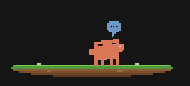
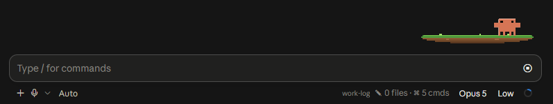
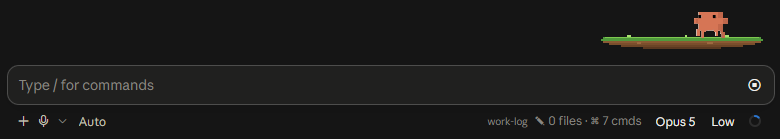
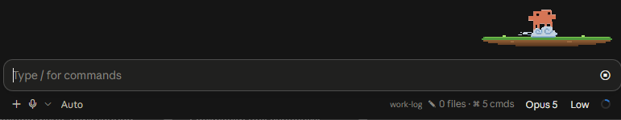
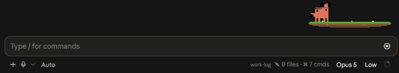
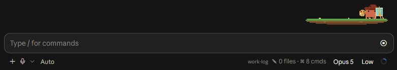

# clawd in your ide!

**English** · [Русский](README.ru.md)

A little animated Clawd who lives above the prompt in the Claude Code desktop
app and acts out whatever Claude is up to. He stands around, wanders the
island, thinks, paints, runs, reads your files, and waves a flag when the turn
is done.



## What it looks like

He lives on a small island in the corner above the input — the chat itself
stays untouched.

**Just standing there.** Between turns he cheers to himself now and then, and
every so often runs off to another spot on the island and back.




**Working.** Once a turn starts the animation follows along: thinking while the
model thinks, gliding by on a cloud, lifting weights, painting at the easel
while it writes.





**Out of the way.** `/clawd off` sends him off for the rest of the session.

## Install

You need the Claude Code **desktop app** — the band is drawn on the `desktop`
surface and hides itself everywhere else (terminal, VS Code, mobile).

```bash
git clone https://github.com/fitchiks/clawd-plugin.git ~/clawd-plugin
```

Then point Claude Code at the folder. Either:

**For good, in every session** — add to `~/.claude/settings.json`:

```json
{
  "env": {
    "CLAUDE_CODE_PLUGIN_DIRS": "~/clawd-plugin"
  }
}
```

Restart the app completely afterwards: the variable is read when the process
starts, not when a new chat opens. Separate several paths with `;` on Windows
and `:` on macOS/Linux.

**For one terminal session:**

```bash
claude --plugin-dir ~/clawd-plugin
```

## Commands

| Command | What it does |
|---|---|
| `/clawd` or `/clawd on` | Show him |
| `/clawd off` | Hide him for the rest of the session |
| `/clawd <animation>` | Play one animation after the current step |
| `/clawd debug` | Current state and the last band draws |

Animations: `idle`, `bounce`, `look`, `stretch`, `hop`, `think`, `glide`,
`paint`, `run`, `lift`, `detective`, `race`, `flag`, `dance`, `sparkle`.

He doesn't show up on the welcome screen — the stock mascot runs that one — and
appears as soon as the chat has its first message.

## How it works

One hooks module, `hooks/register.tsx`, about 440 lines:

- `session.start` registers the `/clawd` command, restores whether he was
  shown, and starts a heartbeat timer that advances the current script.
- `prompt.submit`, `turn.step`, `tool.call` and `turn.complete` pick a script —
  a list of `{ anim, ms, to }` steps — so what he's doing follows what Claude
  is doing.
- `ui.render` on `AbovePrompt` draws him as an inline SVG: one sprite sheet per
  animation, stepped frame by frame through `keyTimes`, plus a horizontal
  translate when he runs from one spot to another.
- Position and the current animation live in `$.state` under `clawd`, typed in
  `types/index.d.ts` — so a hot reload of the module doesn't knock him off his
  spot.

Tests in `hooks/*.test.tsx` cover the band drawing, the finish flag and the
error pose. Run them with:

```bash
claude plugin test .
```

Type-check with `tsc -p .`, once the engine has laid its typings down beside
the plugin.

## Artwork

Clawd himself was drawn by **@volodya**, sticker pack
[AIByVolodya](https://t.me/addstickers/AIByVolodya). The sprite sheets in
`hooks/sprites.ts` are his stickers, re-rendered frame by frame into PNG
sheets. Used with his permission, thanks to him.

The drawings stay his. The MIT license below covers the code in this
repository, but not the artwork: if you fork this and want to keep Clawd —
please ask him too. To put your own character in, replace `hooks/sprites.ts` —
anything of the same `{ png, frames, dur, keyTimes, xs, top, bottom, body, cx }`
shape will do, and nothing else in the module needs changing.

## License

MIT for the code — see [LICENSE](LICENSE). The artwork belongs to @volodya and
is not covered by it, see the **Artwork** section.
